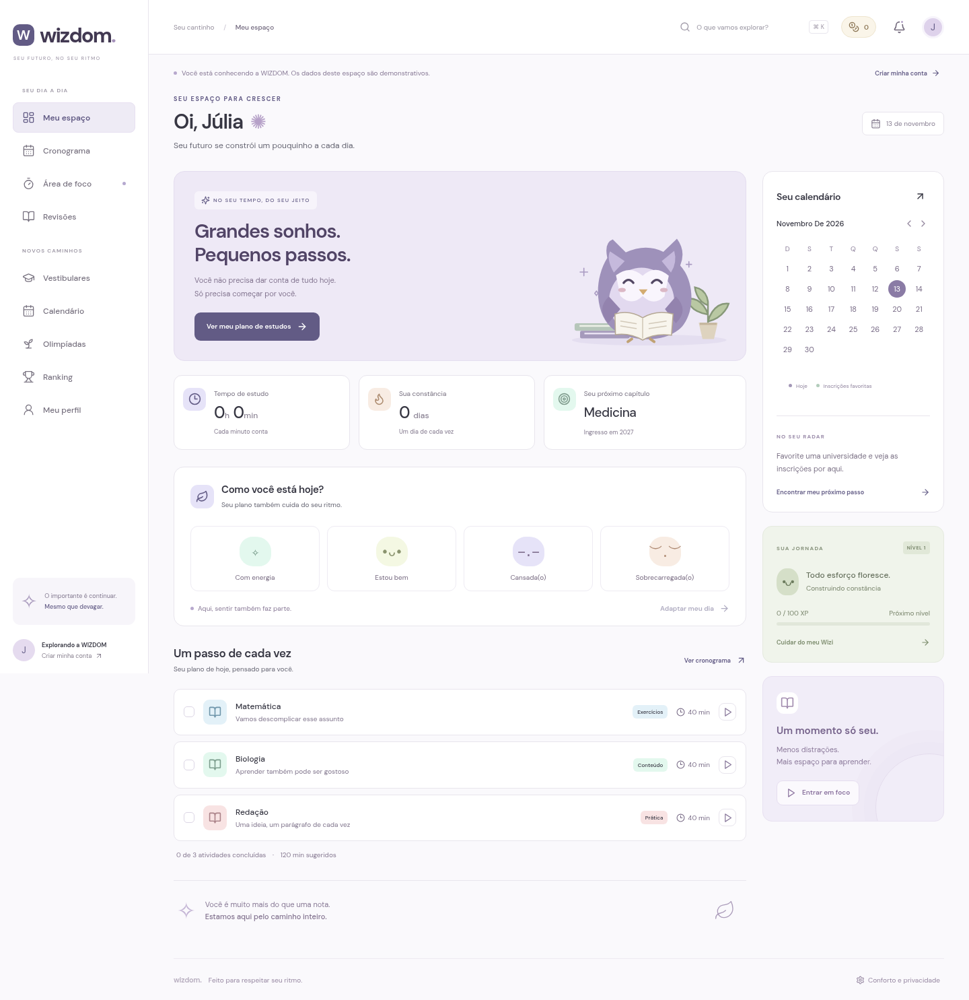

# WIZDOM

**Seu futuro, no seu ritmo.** Protótipo interativo e responsivo de uma plataforma acolhedora para vestibulandos, com a identidade visual do guia WIZDOM.



## Abrir o site com dois cliques

1. Baixe a versão atual em **Code → Download ZIP** no GitHub.
2. Extraia o ZIP para uma pasta no computador.
3. Abra o **`index.html` da pasta principal** com Chrome ou Edge. No Windows, também pode dar dois cliques em **`ABRIR-WIZDOM.bat`**.

**Para usar o protótipo, não precisa instalar Node.js, rodar npm ou abrir um terminal.** O `index.html` já inclui código, estilos, fontes e ícones e pode ser aberto sem internet. Os links para portais oficiais das universidades precisam de conexão.

Mantenha o arquivo na mesma pasta e use o mesmo navegador para continuar com os dados locais. O navegador pode separar dados por endereço do arquivo. Não há sincronização com outros computadores.

## Desenvolvimento (opcional)

Só quem vai editar e reconstruir o código precisa de Node.js 20.19+ ou 22.12+ (validado com **24.22.1**) e npm.

```sh
npm ci
npm run dev
```

No **PowerShell do Windows**, use `npm.cmd` para evitar o bloqueio do `npm.ps1`, sem alterar a política de execução do computador:

```powershell
npm.cmd ci
npm.cmd run dev
```

Depois de editar os arquivos em `src/`, atualize a versão que abre com dois cliques:

```sh
npm run build
```

O build gera um HTML independente em `dist/index.html` e atualiza o `index.html` da pasta principal. Inclua o arquivo atualizado no commit. O ponto de entrada de desenvolvimento fica em `web/index.html`; não edite o HTML gerado manualmente. `npm run preview` também pode servir o build para desenvolvimento, quando necessário.

Não exige chaves, banco de dados ou serviços externos.

## Experimentar

A página inicial abre uma demonstração. Clique em **Criar minha conta** para experimentar o fluxo completo com dados fictícios e uma senha de teste:

1. Cadastro e questionário de três etapas: curso, ingresso, escolaridade, matérias, frequência, rotina, horas e dias disponíveis.
2. Dashboard e cronograma personalizados. O check-in de cansaço/sobrecarga reduz o plano para até 25 minutos de uma matéria favorita, com uma mensagem acolhedora.
3. Área de foco com Pomodoro de 30/5 minutos, temporizador ou cronômetro. A sessão ocupa a interface, permite pausas e saída explícita. Cada minuto completo efetivamente estudado rende **4 XP e 2 moedas**. Descanso não rende pontos. A cada **100 XP**, um novo nível.
4. Perfil com bio, foto e banner locais, gráfico de horas reais, meta e corujinha personalizável. Novas cores podem ser resgatadas com moedas e desbloqueadas por nível.
5. Vestibulares com filtros por curso, instituição e região, notas/ingressos/datas de exemplo e links oficiais. Favoritar adiciona a abertura de inscrições ao calendário interno.
6. Olimpíadas por área, com distinção para estudantes do ensino médio; ranking opcional com colegas fictícios; flashcards de exemplo que agendam revisões para amanhã ou três dias depois.

Os dados de cada conta são separados dos dados da demonstração e persistem neste navegador. Ao atualizar uma sessão de foco, ela é recuperada **em pausa** quando a área de foco é aberta, sem contar o tempo ausente.

## Validação

```sh
npm test          # regras de planejamento e isolamento de estado
npm run test:e2e # inicia servidor isolado e testa os fluxos em Chromium
npm run build
npm run test:standalone # valida o HTML pronto, sem Vite nem dependências em tempo de uso
```

O teste E2E usa `/usr/bin/chromium` por padrão. Em outra máquina, defina `CHROMIUM_PATH` com o executável instalado. É possível fornecer `BASE_URL` para testar um servidor existente, ou `WIZDOM_TEST_PORT` para trocar a porta do servidor isolado (padrão: 5175). Os contextos de teste são descartáveis e não alteram seus dados de demonstração.

O teste standalone tenta abrir o HTML diretamente com `file://`. Se o navegador gerenciado bloquear esse protocolo por política administrativa, o teste informa que essa abertura não foi validada e executa os mesmos fluxos sobre os bytes do HTML, servidos isoladamente em uma origem local. Nenhuma política ou segurança do navegador é desativada. Esse servidor só existe durante o teste; o usuário abre o arquivo diretamente no computador.

Os testes de foco usam o relógio virtual do Playwright para verificar 30 minutos de estudo e pausas sem aguardar esse tempo real.

## Escopo deste protótipo

- **Cadastro/login demonstrativos locais**: senhas de teste são derivadas com PBKDF2/SHA-256 e salt individual; não há autenticação segura em servidor, recuperação de senha, envio de e-mails ou sincronização. Não use senhas reais nem dados sensíveis.
- **Datas e notas de corte são ilustrativas**, não são informações atuais nem recomendações de inscrição. O app exibe esse aviso e aponta para os portais oficiais. Ingresso, campus, modalidade, cotas e ano podem alterar os requisitos.
- **Ranking demonstrativo**, sem compartilhamento de dados de alunos. Nenhum dado pessoal é publicado.
- O calendário é interno; não envia notificações externas nem integra Google Calendar.
- O plano usa regras explicáveis de disponibilidade/preferência/check-in; não diagnostica condições psicológicas. Métricas de estudo são registradas a partir das sessões concluídas; tarefas marcadas manualmente não concedem XP.
- Fotos locais aceitam JPG, PNG ou WebP de até 350 KB cada. Para apagar dados, limpe o armazenamento deste site no navegador.
- Próximas etapas para produção: backend com autenticação, privacidade e proteção de menores, catálogo oficial atualizado, consentimento e notificações, conteúdo pedagógico e validação do planejamento com estudantes.

## Estrutura

- `index.html`: versão pronta e independente para abrir no navegador.
- `ABRIR-WIZDOM.bat`: atalho de abertura para Windows, sem npm ou PowerShell.
- `web/index.html`: ponto de entrada do Vite durante o desenvolvimento.
- `scripts/build.mjs`: gera e verifica o HTML independente.
- `src/App.jsx`: navegação, estado local por conta e integração das páginas.
- `src/lib.js`: planejamento, perfil inicial e derivação de senha de demonstração.
- `src/Auth.jsx`, `src/Onboarding.jsx`: acesso e personalização inicial.
- `src/Dashboard.jsx`: plano diário, check-in, calendário e progresso.
- `src/pages/`: foco, perfil, ranking, vestibulares, calendário e olimpíadas.
- `src/styles.css`: tokens do guia visual, componentes comuns, dashboard e responsividade.
- `tests/`: testes de regras e fluxos completos de navegador.

Paleta: fundo `#FAF9FC`, superfícies brancas, texto `#373743`, secundário `#666673`, borda `#E8E5ED`, ação `#625B85`. Pastéis de apoio do guia: rosa, azul, menta, pistache, lavanda e pêssego. A interface oferece foco visível, controles de conforto, navegação por teclado e respeito a movimento reduzido.
